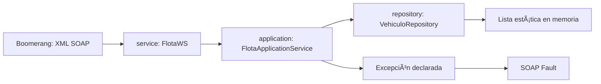

# De Laravel a Java Web SOAP

Tu experiencia con Laravel sirve para separar transporte, reglas y almacenamiento.
En este caso, Payara administra el ciclo de vida del servicio y genera el XML
del contrato a partir de clases y anotaciones Java.

## Equivalencias prácticas

| En Laravel | En este proyecto |
| --- | --- |
| `composer.json` | `pom.xml`: dependencias, plugins y versión Java. |
| `composer install` | Maven resuelve dependencias; `mvn verify` compila, prueba y empaqueta. |
| `Controller` y rutas | `service/FlotaWS` con anotaciones SOAP; el WSDL describe operaciones y parámetros. |
| Servicio de aplicación | `application/FlotaApplicationService`: casos de uso. |
| Modelo de datos | `model/Vehiculo`: POJO con getters, setters y constructor vacío. |
| Eloquent / repositorio | `repository/VehiculoRepository` y su implementación en memoria; no es Active Record. |
| JSON serialization | JAXB transforma objetos y XML. `Serializable` se conserva por requisito académico. |
| Exceptions y handler | Excepción Java declarada que JAX-WS representa como SOAP Fault. |
| `artisan serve` | Desplegar un WAR en Payara desde NetBeans o asadmin. |
| Postman | Boomerang importando el WSDL del servicio. |
| `.env` | Variables del proceso y configuración del servidor; un archivo `.env` no se carga solo. |
| `config/database.php` | En una futura versión con BD: datasource de Payara y JPA/`persistence.xml`. |

`Serializable` no es el mecanismo que convierte a XML: ese trabajo es de JAXB.
JAX-WS es la especificación de servicios; Payara aporta su implementación.

## Recorrido de una petición

- **service:** protocolo, anotaciones, nombres públicos y exposición de las cinco operaciones.
- **application:** coordina CRUD y errores; no depende de Boomerang.
- **repository:** almacena, busca, actualiza, elimina y protege el acceso compartido.
- **model:** representa los datos que también se transmiten mediante JAXB.
- **exception:** excepción y detalle estructurado del error.

Para este tamaño alcanza un solo módulo Maven organizado por paquetes.
Separar módulos Maven o microservicios se evalúa cuando existan límites de negocio
y despliegue que lo justifiquen.

## Configuración por responsabilidad

| Tipo | Dónde vive | Se versiona |
| --- | --- | --- |
| Dependencias y release 21 | `pom.xml` | Sí |
| Plantilla de rutas de herramientas | `config/local.example.ps1` | Sí |
| Rutas reales de cada equipo | `config/local.ps1` | No |
| Puerto HTTP, dominio y JDK del servidor | Instalación local de Payara | Se documenta; no copiar el dominio al repo |
| Nombres SOAP, namespace, firmas | Java y documento de contrato | Sí |
| Futuras claves o credenciales | Entorno / configuración segura del servidor | No |

`config/local.ps1` lo carga explícitamente `scripts/verify.ps1`.
Sus variables ayudan a la terminal, pero no cambian el JDK de un Payara que ya está ejecutándose.
Para futuras propiedades de aplicación se puede usar MicroProfile Config de Payara,
con variables de entorno y `META-INF/microprofile-config.properties`; documentar
la precedencia y las claves cuando se incorporen.

En una futura versión con BD, el código usaría un datasource JNDI, por ejemplo
`jdbc/FlotaDS`; las credenciales se configurarían en el servidor. Este caso usa
memoria y no necesita conexión a una base de datos.

## Detalle que cambia la implementación

`@Stateless` no serializa el acceso a una lista estática entre peticiones.
El repositorio debe proteger cada operación completa con un bloqueo compartido
por todas sus instancias. Generar ID y agregar deben ser una operación indivisible.
Una lista sincronizada por sí sola no protege secuencias de buscar y actualizar.

Retornar copias defensivas de vehículos y de sus mantenimientos impide modificar
el almacenamiento fuera del bloqueo. Los datos se reinician al redesplegar y no
se comparten entre varias instancias del servidor. La arquitectura puede crecer
sustituyendo el repositorio, pero la lista en memoria no escala horizontalmente.

Referencia: [desarrollo SOAP en Payara](https://docs.azul.com/payara-community/technical-documentation/application-development/developing-soap-webservices.html).
